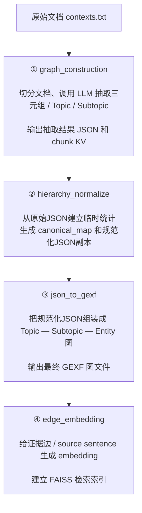

原 TH-RAG 的核心是“用 Topic/Subtopic 层次组织并连接碎片化三元组”；CANON-THRAG 的核心是“先规范化上层语义节点，再缩短 Topic/Subtopic 候选列表并选择进入哪些分支”。它不改变 1-hop traversal 的深度。
暂时不要同时塞 query expansion、cross-encoder、反思模块等太多东西。

## 审计结论与模块状态

重新对照论文、附录和当前公开代码后，CANON-THRAG 的两个基本方向仍然成立，没有因为误解 TH-RAG 而整体失效：

1. 论文明确承认 Topic/Subtopic 语义归一化不充分，因此只规范化这两层节点有直接依据；
2. 原方法确实把完整 Topic/Subtopic 候选表交给 LLM，先做向量 Top-M 预筛是可实现的独立改动。

但原笔记里有几处已经修正的关键误解：subject/object 各自拥有 Topic/Subtopic；K1/K2 只作用于同一套 source-sentence 排名；不计算 chunk score；CANON 不合并 Entity/三元组；论文算法与当前公开 Retriever 在全局 FAISS 预召回、K2 unique-chunk 行为和默认参数上存在差异；softmax 权重、entropy 和 margin 只能作为待校准启发式，不能直接叫真实概率或问题难度。

本文档采用以下标记：

- **【核心】**：结构规范化、Topic/Subtopic Top-M 候选预筛；
- **【后续可选】**：来源文本特征、LLM 合并判定、直接路由/完整列表 fallback、动态 `N_T/N_ST`、动态 `K1/K2`、query expansion、cross-encoder、额外反思模块；
- 标为后续可选的内容全部保留，但实验时必须逐项添加和消融。

## 一、原始 TH-RAG 是怎么做的

TH-RAG 要解决的问题是：LLM 从文档抽取出的三元组图通常很碎。

例如两个 chunk 分别抽出：

```text
(Marie Curie, conducted, research)
(Pierre Curie, studied, radioactivity)
```

即使二者在语义上有关，图中也可能没有直接连接。PathRAG 这类依赖实体路径的方法就可能走不到答案。

TH-RAG 不去强行补实体—实体关系，而是在实体上方增加两层语义节点：

```text
Topic
└─ Subtopic
   ├─ Entity
   ├─ Entity
   └─ Entity
```

借助共同的 Topic/Subtopic，把原本分散的实体挂到同一语义区域中。[原论文与完整方法](https://aclanthology.org/2026.acl-long.1740.pdf)

### 1. 建图阶段

原文档先被切成 chunk。论文设置大致为：

- chunk size：1,200 tokens
- overlap：100 tokens
- 每个 chunk 调用一次 GPT-4o-mini

这次 LLM 调用同时输出：

- `subject–relation–object` 三元组；
- 三元组对应的原始证据句；
- **subject 自己的** Subtopic 和 Main Topic；
- **object 自己的** Subtopic 和 Main Topic。

这里需要注意：不是“整条三元组只属于一个 Subtopic/Topic”。同一条三元组的 subject 和 object 可以被分到不同的 Subtopic/Topic。例如论文附录中的 `Scooter Braun acquired Big Machine Records`，subject 被标为 `Person / Entertainment`，object 被标为 `Record label / Music industry`。同一个实体如果在不同 chunk 中被赋予不同标签，也可能连接到多个 Subtopic。

最终得到三类节点：

- Topic 节点；
- Subtopic 节点；
- Entity 节点。

以及三类边：

- Topic → Subtopic；
- Subtopic → Entity；
- Entity → Entity，即原始三元组关系。

Entity–Entity 关系边还保存该三元组对应的原始 source sentence 和来源 chunk 信息。后面检索时，系统实际排序的是这些 source sentences，并可由排名靠前的 sentence 回到它的原始 chunk。

### 2. 查询阶段

给定问题后，TH-RAG 按以下顺序检索：

```text
问题
 ↓
LLM 从所有 Topic 中选择 N_T 个
 ↓
对每个 Topic，再由 LLM 选择 N_ST 个 Subtopic
 ↓
收集这些 Subtopic 下的 Entity
 ↓
扩展 Entity 的一跳邻居和关系边
 ↓
用 query–source sentence 余弦相似度排序
 ↓
取 Top-K1 个证据句
 ↓
从其中 Top-K2 个证据句恢复完整原始 chunk
 ↓
将 Top-K1 source sentences 和由 Top-K2 sentences 找回的完整 chunks 交给 LLM 回答
```

论文默认：

- `N_T` 一般在 5–10；
- `N_ST` 一般在 10–25；
- `K1=30`：按同一套 query–source sentence cosine 排名，保留前 30 个 source sentences，形成 primary context；
- `K2=5`：在这前 30 个 sentence 中再取排名最靠前的 5 个，找到它们各自的来源 chunk，并把完整 chunk 加入 extended context。

**K2 不是 chunk 检索数量，也不存在 query–chunk 打分。**从头到尾只对 source sentence 排序；K2 只是决定“前多少个 sentence 需要补回完整 chunk”。如果多个 Top-K2 sentences 来自同一个 chunk，去重后实际加入的不同 chunk 数可以小于 K2。

论文和 prompt 要求 LLM 从完整 Topic/Subtopic label 列表中，在固定最小/最大数量之间选择。当前公开 `topic_choice.py`/`subtopic_choice.py` 的 parser 只检查返回列表非空，并截断到 `max`，没有再次强制验证返回数量一定达到 `min`；因此应区分“论文/prompt 的约束”和“当前公开 parser 的实际行为”。

> **论文设置与当前公开代码默认值要区分。**论文主实验报告 chunk size/overlap 为 `1200/100`，并采用 `K1=30、K2=5`。当前仓库 `.env.example` 的默认值则包含 `MAX_TOKENS=3000、OVERLAP=300、TOP_K1=50、TOP_K2=10`，另有 `ALT_MAX_TOKENS=1200、ALT_OVERLAP=100` 和 long-answer 的另一组 K 值。严格复现论文时必须显式把参数设置成论文值，不能直接把仓库默认值当成论文配置；回答温度也应按论文设为 0。

#### 论文算法与当前公开 Retriever 的实现差异

上面的流程是论文 Algorithm 2 的语义。当前公开代码还有两处需要单独记录：

1. **K1 候选顺序不同。**论文是“先通过层次图得到候选 source sentences，再在该候选集合内部计算 cosine 并取 Top-K1”。公开代码则先从全局 edge FAISS 过量召回 `K1 × OVERRETRIEVE_FACTOR`（默认 5 倍），再按已选 Entity IDs 过滤。因此它不一定得到“候选子图内部真正的 Top-K1”，过滤后也可能少于 K1；若过滤结果为空，Retriever 还可能退回全局无过滤搜索，这会掩盖一次路由失败。

   具体例子：假设整张图有 100,000 条 source sentences，Topic/Subtopic traversal 选出的 Entity 分支内共有 200 条候选 sentences，论文设置 `K1=30`。

   - **论文算法：**只在这 200 条内部计算 cosine，排序后一定取得该分支内部最相关的 30 条。
   - **公开代码：**先在全图 100,000 条中取全局 Top-150（`30×5`），再检查这 150 条中哪些边连接已选 Entity。若只有 12 条符合，就只得到 12 条；选定分支中另外 18 条本应进入“分支内部 Top-30”的句子，可能因为全局排名在 151 名之后而永远没被检查。
   - 如果全局 Top-150 中 0 条连接已选 Entity，代码可能直接返回全局高分证据。此时 Topic/Subtopic 路由实际没有找到任何证据，但系统仍可能靠图中其他区域的句子答对，所以会把一次路由失败隐藏掉。

   用集合写就是：论文要计算 `TopK1(C)`，其中 `C` 是层次路由得到的候选集合；公开代码近似计算 `Top(5×K1, All) ∩ C`。一般情况下两者不相等。`OVERRETRIEVE_FACTOR=5` 只是为了过滤后尽量剩下足够结果的工程折中，并不能保证得到候选集合内部真正的 Top-K1。
2. **K2 的 unique-chunk 行为不同。**论文写的是“前 K2 个 sentences 对应的 chunks”；公开实现会沿 K1 的 sentence 排名继续扫描，直到收集到 K2 个不同的 source chunks。如果前几个 sentences 来自同一 chunk，公开代码可能越过第 K2 个 sentence。

实验必须预先选择并固定协议：

- **代码复现协议：**按公开 Retriever 跑，同时记录实际返回 sentence 数、`OVERRETRIEVE_FACTOR`、实际 unique chunks 和 global-fallback rate；
- **论文忠实协议：**在层次图候选集合内部做 exact cosine，严格取前 K1 sentences，再按前 K2 sentences 回取并去重 chunks。

TH-RAG 与 CANON 必须使用同一协议。不能在 CANON 中顺便修正 Retriever，却仍把提升全部归因于规范化或路由；最好主文选一个协议，另一个放兼容性实验。

### 3. 原方法为什么有效

它的优势主要来自两个地方：

1. Topic/Subtopic 把原本孤立的实体连接起来。

   在 Legal 数据上，最大连通分量从 LightRAG 的 56.11% 提升到 99.98%。

2. 最终回答不只依赖抽象三元组。

   它保留原始句子，并对最相关证据恢复完整 chunk。论文 Table 7 中，去掉 chunk 后 Accuracy 从 0.722 降到 0.580，说明完整上下文很重要。

### 4. 原方法目前的问题

#### 问题 A：Topic/Subtopic 的语义归一化不充分

LLM 可能生成：

```text
sport
sports
athletics
competitive sports
```

或者：

```text
film director
director
movie directors
```

这些标签可能表示同一个概念。原方法能够复用完全相同的标签，但没有解决近义、单复数、粒度略有差异等**语义等价但字符串不同**的情况，因此仍会形成多个相似节点。论文 Limitations 也明确举出了 `sports/sport`、`film director/director`，并建议未来研究 embedding-based clustering。

结果是：

- Topic/Subtopic 数量膨胀；
- 同一批实体散落在多个近义节点下；
- Topic/Subtopic 候选列表变长，可能使 LLM 选择多个语义重复分支；
- 后续候选实体和 source sentences 可能出现冗余。

#### 问题 B：Topic/Subtopic 选择范围以及 K1/K2 都使用预设值

原论文的 Topic/Subtopic prompt 要求在给定的最小值和最大值之间选择；`K1/K2` 也由人工预先设定。这里的 `K1/K2` 仍然只表示“保留多少 source sentences”和“为前多少个 sentence 恢复 chunk”，不是 chunk 打分参数。

但不同问题需要的检索量明显不同：

- 简单问题可能只需少量 Topic/Subtopic；
- 多跳问题可能需要多个 Topic/Subtopic；
- 模糊问题需要扩大搜索；
- 明确问题继续展开反而可能引入无关实体和 source sentences。

论文的大规模实验也说明选择范围需要随语料规模调整：图扩大到约 11M tokens 后，作者手工把最大 `N_T` 从 10 调到 20、`N_ST` 从 25 调到 50，Accuracy 从 0.587 恢复到 0.614。这能支持“固定范围未必适合所有语料规模”，但**不能单独证明每道简单/复杂问题都应使用不同 K1/K2**；后者仍是需要实验验证的扩展假设。

#### 问题 C：每次查询需要多次 LLM 选择

原方法一般需要：

- 1 次 Topic 选择；
- 每个选中 Topic 再做一次 Subtopic 选择。

因此调用数大致是 `N_T+1`：1 次 Topic 选择，加上 `N_T` 次 Subtopic 选择。当前公开实现可以并发执行多个 Subtopic 调用，所以调用数增加不等于墙钟延迟严格线性增加；但完整候选列表仍会增加 prompt tokens 和 API 成本。论文 Table 6 中，TH-RAG 查询/检索阶段约 3.54 秒，仍慢于 GraphRAG-L 的 0.77 秒。

---

# 二、CANON-THRAG 与原方法有什么区别

整体流程可以这样对照：

```text
原 TH-RAG
文档 → LLM抽取JSON → 组装层次图 → 建立source-sentence索引
                                  ↓
问题 → LLM选Topic → LLM选Subtopic → sentence cosine排序
                                      ↓
                         Top-K1 sentences + Top-K2对应chunks → 回答


CANON-THRAG
文档 → 同一份LLM抽取JSON → 生成canonical mapping和规范化JSON
                                         ↓
                           最终层次图 → 建立source-sentence索引
                                         ↓
问题 → Topic/Subtopic向量预筛 → LLM在较短候选表中选择
                                         ↓
                    保持同一套sentence排序、K1和K2语义 → 回答

【后续可选】
候选分数足够明确时绕过LLM；动态选择N_T/N_ST；再单独研究动态K1/K2。
```

上图中的“核心修改”只有两类：上层语义节点规范化，以及 Topic/Subtopic 候选预筛。Entity、Entity–Entity 三元组、source sentence、chunk 和原始回答流程保持不变。后续可选模块必须分别做消融，不能把它们和核心修改混成一个不可解释的大模块。

## 改进一：结构感知的层次规范化【核心】




官方 `graph_build` 实际包含：

```text
graph_construction → json_to_gexf → edge_embedding
```

CANON-THRAG 建议改成：

```text
graph_construction → hierarchy_normalize → json_to_gexf → edge_embedding
```

`hierarchy_normalize` 以原始 extraction JSON 为权威输入：从 JSON 中临时统计 Topic/Subtopic 的下属实体、关系和来源；只改 subject/object 的 `main_topic`、`subtopic` 字段，三元组、实体名称、sentence 和 chunk_id 原样保留；同时输出 `canonical_map.json` 和一份规范化 JSON。随后让原 `json_to_gexf` 自动组装最终图，避免在 GEXF 上手工重连边。

采用这个顺序还有两个原因：

1. 来源 chunk/provenance 在 extraction JSON 中最完整，仅从 GEXF 后代实体反查可能因全局共享 Entity 而串入无关 chunk；
2. `aliases/merged_from/source_chunks` 等列表更适合保存在 companion `canonical_map.json`，不要假定当前 GEXF 能稳定保存复杂数组属性。要支持撤销，必须保留原始 JSON/GEXF；只保存几个来源 ID 并不足以完整恢复所有旧邻接。

如果一个 TH-RAG 图和 edge FAISS 已经全部建好，而规范化只改变 Topic/Subtopic，Entity、三元组、source sentence 和 Entity IDs 均不变，那么官方 edge FAISS 在逻辑上可以复用，因为它索引的是 predicate-edge source sentences，payload 主要关联 Entity IDs。新增的 Topic/Subtopic index 必须在规范化后建立。把规范化放到 `edge_embedding` 之前是更干净的流水线和版本管理选择，不是因为上层节点一改，原 edge FAISS 就必然失效。

> 论文形式化使用 Topic→Subtopic→Entity 的有向记号；当前公开 `json_to_gexf.py` 使用的是 NetworkX `Graph`（无向图）。本文档中的箭头表示语义层级，不表示公开代码一定使用有向边。

## 规范化到底改什么

规范化阶段只处理：

- Topic ↔ Topic 的近义重复；
- Subtopic ↔ Subtopic 的近义重复；
- 合并后 Topic–Subtopic、Subtopic–Entity 边的重新挂接。

明确不处理：

- 不合并 Entity；
- 不改写 subject–relation–object；
- 不删除或重新生成 Entity–Entity 关系边；
- 不修改原始 source sentence 和 chunk。

例如：

```text
合并前：
topic_17: sport  → Football, Basketball
topic_63: sports → Football, Tennis

合并后：
topic_sports: Sports → Football, Basketball, Tennis
```

这只是把两个上层节点的已有连接取并集。下面的 Entity 和三元组保持原样。

系统不能仅凭 label embedding 相似就自动合并，而应把它作为“候选对召回”信号，再检查结构证据。大图中 Subtopic 可达数万，不能做所有节点两两比较的 `O(n²)`；应先为每个节点召回少量同层 Top-L label 候选，再做结构判定。

### 1. 标签语义

例如：

```text
cosine(embed("sport"), embed("sports"))
```

用于找出可能需要进一步检查的候选对。高 label cosine 只表示名字像，不代表一定能合并。

### 2. 下属实体集合是否相似

假设两个 Subtopic 分别连接：

```text
sports → football, basketball, baseball
sport  → football, tennis, basketball
```

它们的下属实体集合高度重合，支持合并。这里比较的只是实体集合或实体名称表示，不会把这些 Entity 本身合并。

但：

```text
commercial bank → JPMorgan, deposits, financial institution
river bank      → river, erosion, floodplain
```

两个不同标签都包含 `bank`，embedding 可能较相似，但下属实体明显冲突，所以不能合并。

### 3. 关系分布是否相似

比较两个节点下常见关系的分布，例如：

```text
born_in / played_for / won
```

与：

```text
contains / cultivated_in / tastes_like
```

Topic/Subtopic 本身没有这些 Entity–Entity 关系；这里是收集其下属 Entity 所连接的关系类型，再比较关系分布。关系分布不同可以帮助避免错误合并。

### 4. 来源文档和上下文【后续可选】

通过下属三元组可以追溯到 source sentence 和 chunk。比较这些来源文本，是为了区分 `Apple company` 与 `apple fruit`、`commercial bank` 与 `river bank` 这类标签相似但语义冲突的候选。它只是辅助消歧或否决证据，不要求两个待合并节点出现在同一个 chunk，也不参与查询时的回答上下文。为控制实现复杂度，可以先只保留来源 ID 供人工审计，后续再加入上下文向量相似度。

## 一个更清楚的合并流程

```text
1. 只在同一层内找候选：Topic对Topic，Subtopic对Subtopic
2. label相似度低：直接不合并
3. label相似度高：检查下属实体、父Topic和关系分布
4. 结构相容且没有明显冲突：合并
5. 明显冲突：不合并
6. 无法判断：保留两个节点；或【后续可选】交给LLM判断
7. 合并时只重接上层边，并记录旧节点和来源
```

其中“父节点相容”主要针对 Subtopic：例如 `Programming Language → Java programming language` 与 `Geography → Java island` 即使标签 embedding 相近，也不能合并。Topic 没有父 Topic，不适用这条约束。

当前公开建图代码会按规范化后的 label ID 复用完全同名节点。因此，`Java`/`Java` 这类已经被原代码合成一个节点的同名异义问题，单纯 post-hoc merge 模块无法再拆开。本方案只解决“不同但近义的标签是否合并”，不声称解决 exact-label polysemy。若以后要拆分同名异义节点，需要在 `json_to_gexf` 之前引入 context-sensitive node IDs，这是另一个【后续可选】问题。

### 加权合并分数【后续可选，不是必须实现】

如果后续希望把上述规则写成统一分数，可以定义：

可以定义一个合并分数：

\[
S(u,v)=
w_1\operatorname{cos}(label_u,label_v)
+w_2\operatorname{cos}(entityCentroid_u,entityCentroid_v)
+w_3Jaccard(N_u,N_v)
+w_4Sim(RelDist_u,RelDist_v)
\]

其中：

- `label`：Topic/Subtopic 标签向量；
- `entityCentroid`：Subtopic 使用直接相连 Entity 名称向量的平均值；Topic 使用所有子 Subtopic 后代 Entity 的并集向量；
- `N`：同样按上述定义得到的下属 Entity 集合；
- `RelDist`：下属 Entity 所连接的关系类型分布；
- `w1...w4`：在人工标注的 merge-pair development set 上调整的权重，不能在最终 QA test 上调。

这个分数不是“自动真理”，只是把多项证据合成一个候选分数。即使分数高，违反下面的硬约束仍不能合并。第一阶段完全可以不用这个公式，而使用前面的逐步规则。

合并也不能简单使用一次阈值加 union-find：可能出现 A≈B、B≈C，但 A 与 C 明显冲突的传递链。每次把节点加入已有 cluster 前，都要做 cluster-level 复核；至少当新节点与任一已有成员存在强冲突时拒绝合并。先规范化 Topic，再依据规范化后的 parent sets 规范化 Subtopic。

硬约束：

- 只能合并同一层级的节点；
- 对 Subtopic，规范化后的父 Topic 集合应至少有重叠或语义相容；原方法允许一个 Subtopic 连接多个 Topic，因此不能简单要求“只有一个且完全相同的父 Topic”，只有强冲突才否决；
- 下属实体不能明显冲突；
- 任何合并都不能修改 Entity、Entity–Entity 三元组、source sentence 或 chunk；
- 【后续可选】模糊候选才交给 LLM 判断；
- 必须保存别名、原节点 ID 和来源信息，以便审计和撤销错误合并。

合并后仍然有一个用于展示和路由的统一字符串，但节点不能只保存这个字符串，还应保留合并记录。例如：

```json
{
  "id": "topic_sports",
  "canonical_label": "sports",
  "aliases": ["sport", "competitive sports", "athletics"],
  "merged_from": ["topic_17", "topic_63"],
  "source_chunks": ["chunk-00028", "chunk-00104"]
}
```

- `canonical_label`：查询时使用的统一名称；
- `aliases`：旧标签，可用于别名匹配；
- `merged_from`：原始节点 ID；
- `source_chunks`：这些节点通过下属三元组追溯到的来源，仅用于 provenance/审计，不需要全部放入回答 prompt。

`canonical_label` 最好从已有 aliases 中选择出现频率最高或最接近 cluster 中心的 label（medoid），不要让 LLM随意创造新名称。路由 embedding 应包含 canonical label 与 aliases，否则合并后可能丢失用户查询与旧别名之间的匹配。

规范化也不保证候选一定减少：合并节点后其邻域取并集，选中该分支时可能触达更多 Entity 和 source sentences，反而引入噪声。因此所有“减少候选、提高召回、降低成本”都只是待验证假设；实验应报告平均选中 Topic/Subtopic 数、触达 Entity 数、K1 前的候选 sentence 数以及最终 context tokens。

### 与原方法的实质区别

| 方面 | 原 TH-RAG | CANON-THRAG |
|---|---|---|
| Topic 身份 | 基本按生成标签区分 | 标签、实体邻域、关系和来源联合判断 |
| 同义标签 | 容易形成多个节点 | 合并到 canonical node |
| 不同但相似、实际含义不同的标签 | 可能被简单 embedding clustering 误合并 | 用实体/关系约束拒绝合并 |
| 完全同名但含义不同 | 原代码可能已复用同一节点 | 当前 merge-only 方案不解决；拆分属于后续扩展 |
| 图更新 | 直接使用抽取结果 | 增加规范化、合并和重新挂接 |
| 可追踪性 | 保存证据句 | 额外保存节点合并 provenance |
| Entity/三元组 | 使用原始抽取结果 | **完全保持不变，不做实体合并** |

## 改进二：Topic/Subtopic 候选预筛【核心】与自适应路由【后续可选】

原方法把完整 Topic 列表交给 LLM；选出 Topic 后，又把每个 Topic 下的完整 Subtopic 列表交给 LLM。改进二首先解决的是“候选列表过长”，不是直接改动 source-sentence 检索。

### A. 候选预筛【核心】

在规范化完成后，另外为 canonical Topic 和 Subtopic 建立小型 embedding index；当节点数不大时也可以直接做矩阵 cosine，无需强行使用 ANN/FAISS。它们与原来的 edge/source-sentence FAISS 作用不同：

- Topic/Subtopic index：决定进入图中的哪些上层分支；
- 原 edge index：在选定分支后，对候选 source sentences 做检索和排序。

问题到来后先检索 Top-M 候选：

```text
全部 500 个 Topic
        ↓ query–Topic embedding similarity
最可能的 20 个 Topic
        ↓
LLM只在这20个Topic中选择
```

Topic 在所有 canonical Topic 中预筛；Subtopic 必须只在**当前已选 Topic 的直接 Subtopic 邻居**中预筛，不能跨全图做全局 Subtopic Top-M，否则会破坏原层次遍历。`M_topic` 与 `M_subtopic` 应分别设置。

为了不让向量预筛成为无法恢复的召回瓶颈，M 必须明显大于最终允许选择的最大数量，并在 validation set 同时检查：

1. **baseline-retention：**原 TH-RAG 的 LLM 所选节点有多少仍包含在 Top-M；
2. **routing recall：**从 gold supporting chunks/edges 反查出的必要 Topic/Subtopic，有多少包含在 Top-M。

第一项只是与 baseline 的一致性，不是真正 gold；第二项才更接近“关键路径是否被预筛保留”。若 Top-M 漏掉关键 Topic，后面的 LLM 无法补救。应画 `candidate recall–routing prompt tokens` 曲线选择 `M_topic/M_subtopic`，而不是只报一个任意 M。

这一核心版本仍然调用 LLM，只是缩短它看到的候选列表，因此主要减少 routing prompt tokens 和干扰项，**不会自动减少 LLM 调用次数**。

### B. 候选分数、margin 与 entropy【后续可选：用于直接路由或触发 fallback】

对问题 `q` 和候选节点 `v_i` 计算：

\[
s_i=\cos(embed(q),embed(v_i))
\]

`s_i` 是 cosine 相似度，不是概率，也不表示该 Topic 一定正确。

#### top-1/top-2 margin

将相似度从高到低排列，第一名和第二名的差为：

\[
m=s_{(1)}-s_{(2)}
\]

例如第一名 0.92、第二名 0.55，margin 为 0.37，表示第一名明显领先；如果是 0.72 和 0.70，margin 只有 0.02，表示前两名难以区分。margin 只适合判断“是否明显只有一个第一名”，不适合直接处理多标签路由。例如 `0.91、0.86、0.24、0.12` 的 top-1/top-2 margin 很小，但实际上前两个共同形成了非常清楚的相关头部。

#### entropy

若要计算 entropy，先用带 temperature `T` 的 softmax 把 Top-M cosine 转成总和为 1 的**归一化权重**：

\[
w_i=\frac{\exp(s_i/T)}{\sum_j\exp(s_j/T)}
\]

再计算归一化 entropy：

\[
H_{norm}=\frac{-\sum_i w_i\log w_i}{\log M}
\]

- `H_norm` 低：权重集中在少数候选，embedding 路由较明确；
- `H_norm` 高：很多候选权重接近，embedding 难以区分。

这里必须叫“归一化权重/分布集中度”，不能直接写成真实的 `p(v|q)` 或校准置信度。它高度依赖 Top-M 和 temperature；而且 softmax 即使面对一组全部很低的 cosine，也会被迫归一成总和 1，不能发现“所有候选其实都不相关”。`T`、margin 阈值、entropy 阈值只能在 routing/QA validation set 上确定。高 entropy 也可能意味着问题确实跨多个 Topic，并不等于问题本身一定“困难”。

因此 margin/entropy 只能作为探索性触发信号。对于多标签路由，更自然的备选包括：

- 找排序分数中的最大相邻落差，把落差前的多个节点作为候选；
- 为每个 Topic 独立做 sigmoid/阈值校准，而不是让所有 Topic 通过 softmax 相互竞争；
- 仍让 LLM 在 Top-M 中做多选，只把分数用于预筛而不直接替代 LLM。

【探索性后续可选】可以采用三段路由：

```text
分布很集中 → 直接采用少量高分节点，跳过LLM
中等情况   → LLM只在Top-M候选中选择
非常平坦，或绝对最高 cosine 也很低 → 回退到原TH-RAG的完整列表LLM选择
```

这样即使预筛不可靠，仍有完整列表 fallback；但这需要单独证明减少了调用或 token，而没有损失召回。

这里的 fallback 只表示“从 Top-M 候选表退回完整 Topic/Subtopic 列表”，不是 no-answer detector。softmax 总会把权重归一为 1，因此不能靠 entropy 判断问题是否属于 Null/无答案类型；若要拒答，需要独立的证据充分性或 abstention 模块，属于另一项【后续可选】工作。

### C. 动态选择 N_T/N_ST【探索性后续可选】

如果使用上面的归一化权重，可以把候选按 `w_i` 从高到低排列，选择最小的 `k`，使累计权重达到阈值：

\[
k^*=\min\left\{k:\sum_{i=1}^{k}w_{(i)}\ge\tau\right\}
\]

例如权重为 `0.55、0.25、0.12、0.08`，令 `τ=0.80`，前两个累计正好 0.80，所以选择两个 Topic。再用 `k_min/k_max` 限制过窄或过宽。

这仍然只是基于 softmax 权重的启发式，不是概率保证。必须在 validation set 调 `T、τ、k_min、k_max`，并与固定 `N_T/N_ST` 在相同成本下比较。

### D. 动态 K1/K2【后续可选，和层次路由分开研究】

原方法的唯一排序对象是 source sentence：

```text
1-hop 后得到候选 source sentences
→ query–sentence cosine 排序
→ 前 K1 个 sentence 形成 primary context
→ 在这 K1 个中取排名前 K2 的 sentence
→ 按这 K2 个 sentence 的来源恢复完整 chunks
```

不存在 query–chunk cosine、chunk score 或 chunk 概率聚合。若以后动态调整：

- 动态 `K1(q)`：在同一套 sentence 排名上决定保留前多少个 sentence；
- 动态 `K2(q)`：仍在同一套 sentence 排名上决定前多少个 sentence 需要恢复来源 chunk。

多个 Top-K2 sentences 可能来自同一个 chunk，所以成本比较必须报告实际 unique chunks 和最终 context tokens，不能把 K2 直接当作 chunk 数。该扩展应单独消融；在规范化和层次路由实验中先保持论文的 `K1=30、K2=5`。

## 为了保证因果归因，哪些东西保持不变

为了使论文贡献可解释，规范化和层次候选预筛的主实验应保持以下部分与原论文一致：

- 相同 chunk 切分；
- 相同 LLM 抽取三元组/Topic/Subtopic；
- 相同实体一跳扩展；
- 相同 source sentence；
- 相同回答模型和 prompt；
- 相同数据划分；
- `K1=30、K2=5`，且严格使用原文的 sentence 排名与 chunk 恢复方式；
- 暂时不加 query expansion；
- 暂时不加新的 cross-encoder reranker。

核心对比的差异只有：

1. 原始层次图是否规范化；
2. LLM 是否从完整 Topic/Subtopic 列表选择，还是先经过 Top-M 候选预筛。

【后续可选】直接路由/完整列表 fallback、动态 `N_T/N_ST`、动态 `K1/K2` 都保留，但应逐个添加和消融，不能把它们默认算进同一个黑盒方法。

否则，如果同时加入 reranker、query expansion 和新生成模型，即使结果提高，也无法证明提升来自 CANON。

---

# 三、实验应该和原论文的哪些表比较

最重要的原则是：

> 必须自己重跑原始 TH-RAG；不能只拿自己新实验的数字与论文中 2026 年的旧数字直接比较。

因为 TH-RAG 使用 GPT-4o-mini 和 OpenAI embedding，模型版本、API输出、随机性、数据预处理都可能变化。

## 对照原论文 Table 3：主结果

这是最重要的主表，包含：

- MultiHop-RAG；
- HotpotQA；
- 回答指标：F1、Precision、Recall、Accuracy；
- chunk 检索指标：Recall、F1、Recall@5、NDCG@5。这里评测的是“预测 chunk ID 与包含 supporting evidence 的 gold chunks”，不是三元组召回。

原始 TH-RAG 的关键结果：

| 数据集 | Answer F1 | Accuracy | Retrieval Recall | Retrieval NDCG@5 |
|---|---:|---:|---:|---:|
| MultiHop-RAG | 0.712 | 0.722 | 0.405 | 0.555 |
| HotpotQA | 0.671 | 0.612 | 0.886 | 0.893 |

特别值得注意的是：

- MultiHop-RAG 上 HyperGraphRAG 的 chunk Retrieval Recall/F1 是 0.426/0.283，高于 TH-RAG 的 0.405/0.271；TH-RAG 胜在 NDCG@5 0.555 和回答质量。
- HotpotQA 上 TH-RAG 的回答 F1 0.671 略低于 HyperGraphRAG 的 0.674；TH-RAG 胜在 Accuracy 0.612，以及更好的 chunk Retrieval Recall/F1/NDCG。

因此不能写成“TH-RAG 所有指标都最佳”。CANON 应重点验证：规范化和候选预筛能否提高或保持 chunk recall、排序质量和最终回答，同时降低路由成本。

为避免选择性报告，建议把回答和检索拆成两张表，保留论文的完整指标。

**回答表：**

| Method | MultiHop F1 | Precision | Recall | Acc | Hotpot F1 | Precision | Recall | Acc |
|---|---:|---:|---:|---:|---:|---:|---:|---:|
| NaiveRAG（重跑） | | | | | | | | |
| GraphRAG-L（重跑） | | | | | | | | |
| HyperGraphRAG（尽量重跑） | | | | | | | | |
| TH-RAG（论文报告） | | | | | | | | |
| TH-RAG（本环境重跑） | | | | | | | | |
| CANON-THRAG | | | | | | | | |

**Chunk retrieval 表：**

| Method | MultiHop Recall | F1 | Rec@5 | NDCG@5 | Hotpot Recall | F1 | Rec@5 | NDCG@5 |
|---|---:|---:|---:|---:|---:|---:|---:|---:|
| NaiveRAG（重跑） | | | | | | | | |
| GraphRAG-L（重跑） | | | | | | | | |
| HyperGraphRAG（尽量重跑） | | | | | | | | |
| TH-RAG（论文报告） | | | | | | | | |
| TH-RAG（本环境重跑） | | | | | | | | |
| CANON-THRAG | | | | | | | | |

其中“论文报告”和“你的环境重跑”必须分成两行。

## 对照 Table 4 和 Table 14：图结构

原 Table 4 比较 Legal 数据上的 TH-RAG 与 LightRAG，并额外报告子图数量和最大连通分量比例；Table 14 列出了六个语料的 Topic/Subtopic/Entity 节点与三类边数量，**但没有为六个语料报告子图数量和最大连通分量**。CANON 可以自行给六个语料补算这些指标，但要明确标成新增实验，并说明连通分量是按弱连通还是无向化后计算。

> **原论文 Table 4 自身有内部矛盾，引用时必须标注。**表中 LightRAG 总边数写为 24,707，但 Entity–Entity 边写为 34,027，不可能子类边多于总边；TH-RAG 三类边也无法按表中该行相加到 94,507。Table 14 对 Legal 的 TH-RAG 给出 Topic–Subtopic 19,212、Subtopic–Entity 41,268、Entity–Entity 34,027，三者正好合计 94,507。不能擅自替作者改 Table 4；TH-RAG 的 Legal 结构数使用 Table 14，LightRAG 结构数以本地重跑为准。

CANON 应比较规范化前后：

- Topic 数量；
- Subtopic 数量；
- Entity 数量（按设计应保持不变）；
- Topic–Subtopic 边；
- Subtopic–Entity 边；
- Entity–Entity 边（按设计应保持不变）；
- 子图数量【CANON 对六个语料新增计算】；
- 最大连通分量比例【CANON 对六个语料新增计算】。

但仅仅“节点变少、最大连通分量变大”不够。错误合并同样会产生巨大连通分量。

因此新增：

- 标签重复率；
- 节点压缩率；
- 人工标注的 merge precision；
- merge recall【后续可选：需要对候选全集进行较完整标注，成本高】；
- 错误合并率；
- 原始实体、证据句保留率；
- provenance 完整率。

还应加入硬性不变量检查：规范化前后 Entity 集合、Entity–Entity triples、source sentences 和 chunk IDs 必须完全一致。若这些内容发生变化，说明实现超出了“只规范化 Topic/Subtopic”的定义。

公平的隔离实验应当是：

```text
同一份 LLM 原始抽取结果
          ├─ 原 TH-RAG：直接建图
          └─ CANON：规范化后建图
```

不能分别重新调用 LLM 建两张图，否则抽取随机性会混入结果。

## 对照 Table 5：不同问题类型

原文在 MultiHop-RAG 上分成：

- Comparison；
- Temporal；
- Inference；
- Null。

原 Table 5 没有在表头明确写 metric；结合数值与主表，它应是按问题类型统计的 Accuracy，但正式写作前仍应通过官方评测脚本确认。暂记为 `Per-type Accuracy（根据论文上下文推断）`：

| 类型 | TH-RAG | HyperGraphRAG |
|---|---:|---:|
| Comparison | 0.625 | 0.538 |
| Temporal | 0.509 | 0.197 |
| Inference | 0.954 | 0.938 |
| Null | 0.786 | 0.664 |

CANON 也应按类型报告。

这里尤其值得看：

- `Null`：这是无答案/证据不足类型，应报告 abstention accuracy 和 false-answer rate，不能简单假定“少检索一定更好”；
- `Inference`：规范化是否错误合并 Topic/Subtopic，从而把无关 Entity 分支混进候选；这里不涉及 Entity 合并；
- `Comparison`：能否覆盖多个并行 Topic；
- `Temporal`：规范化和路由后是否仍能召回时间相关证据；当前核心方案没有新增 evidence reranker，不能写成“检验证据重排”。

## 对照 Table 6：效率

原论文的效率表只针对 MultiHop-RAG：

| 方法 | Index calls | Index tokens | Query/Retrieval time | Context tokens |
|---|---:|---:|---:|---:|
| LightRAG | 5,978 | 8M | 2.66s | 25K |
| HyperGraphRAG | 2,772 | 20.3M | 9.78s | 20K |
| GraphRAG-L | 4,354 | 15M | 0.77s | 13.6K |
| TH-RAG | 902 | 2.3M | 3.54s | 7.4K |

其中 902 calls/2.3M tokens 是整个 MultiHop-RAG 语料索引阶段的总量；3.54 秒是查询/检索阶段时间，不能直接称为包含最终回答生成的端到端延迟。

CANON 需要补充更多列：

| 方法 | 建图调用/tokens | 规范化时间/成本 | 调用路由LLM的问题占比 | 平均路由LLM calls/query | 路由prompt tokens/query | Query p50/p95 | Generator context tokens |
|---|---:|---:|---:|---:|---:|---:|---:|
| TH-RAG 重跑 | | 0 | 100% | | | | |
| CANON：只规范化 | | | 100% | | | | |
| CANON：Top-M预筛+LLM | | | 100% | | | | |
| CANON：含直接路由/fallback【后续可选】 | | | | | | | |

要注意：

- 规范化会增加离线 embedding/聚类计算；若灰区候选调用 LLM，还要单列 API calls/tokens，不能只报告查询变快；
- 原 TH-RAG 不是“fallback 率 100%”，而是所有问题都使用 routing LLM；fallback 是 CANON 才可能有的机制；
- 路由成本不仅由 calls 决定，还受到完整 Topic/Subtopic 列表造成的 prompt 长度影响；
- 延迟必须在同一机器、同一 API、同一缓存策略下重跑；
- 论文旧延迟只能作为参考，不能与新延迟直接做百分比提升。

## 对照 Table 7：方法消融

原 Table 7 验证的是 TH-RAG 自身组件：

| 设置 | Accuracy | F1 | Recall | Precision |
|---|---:|---:|---:|---:|
| 完整 TH-RAG | 0.722 | 0.712 | 0.720 | 0.710 |
| 去掉 chunks | 0.580 | 0.576 | 0.577 | 0.577 |
| 去掉 triplets | 0.692 | 0.680 | 0.691 | 0.678 |
| 去掉 traversal | 0.624 | 0.620 | 0.622 | 0.620 |

- `w/o chunks`：从最终 context 移除完整 chunk，不是取消原始文档 chunking；
- `w/o Triplets`：移除 triplet/source-sentence 层级信息；
- `w/o Traversal`：不做 Topic/Subtopic traversal，直接对所有 sentences 过滤。

这些数字只能证明原 TH-RAG 的 chunk、triplet 和 traversal 有用，不能证明 CANON 的新模块有用。

你必须新增自己的消融表。主文先用清楚的 2×2 主体：

| 设置 | Topic/Subtopic规范化 | Top-M候选预筛 | 原LLM选择器 | Answer F1 | Chunk Ret. Recall | Routing calls/tokens |
|---|---|---|---|---:|---:|---:|
| TH-RAG |  |  | ✓（完整列表） | | | |
| Normalization only | ✓ |  | ✓（完整列表） | | | |
| Prefilter only |  | ✓ | ✓（Top-M列表） | | | |
| CANON core | ✓ | ✓ | ✓（Top-M列表） | | | |

【后续可选】再增加：

| 设置 | 直接路由 | 完整列表fallback | 动态N_T/N_ST | 动态K1/K2 | Answer F1 | Chunk Ret. Recall | Cost |
|---|---|---|---|---|---:|---:|---:|
| CANON core |  |  |  |  | | | |
| + direct routing | ✓ |  |  |  | | | |
| + safe fallback | ✓ | ✓ |  |  | | | |
| + dynamic hierarchy width | ✓ | ✓ | ✓ |  | | | |
| + dynamic evidence budget | ✓ | ✓ | ✓ | ✓ | | | |

结构规范化内部的 label/entity-neighbor/relation/source-context 特征消融可以放附录。每个规范化变体还应报告 merge precision 和硬性不变量检查结果。

这张表通常比“和所有外部方法比较”更重要，因为它决定审稿人是否相信你的贡献。

## 对照 Table 8：固定 K1/K2；动态 K1/K2 属于【后续可选】

Table 8 报告的是 MultiHop-RAG **Accuracy**。K1 是保留的 Top source sentences 数；K2 是在 Top-K1 中取前 K2 个 sentence，并恢复它们的来源 chunk。K2 不保证得到 K2 个不同 chunk。

原文已经证明调大固定预算可以提高结果：

| K2 \\ K1 | 5 | 10 | 30 | 50 |
|---|---:|---:|---:|---:|
| 1 | 0.536 | 0.565 | 0.622 | 0.630 |
| 3 | 0.662 | 0.679 | 0.697 | 0.702 |
| 5 | 0.697 | 0.685 | 0.720 | 0.719 |
| 10 | — | 0.714 | **0.743** | 0.726 |

默认 `K1=30,K2=5` 在该 sweep 中是 0.720，但固定 `30/10` 达到 0.743，是**该网格在 MultiHop-RAG 上测到的最佳点**，不能称为跨数据集最佳超参数。Table 8 的 0.720 与主 Table 3 的 0.722 可能来自独立 sweep 或舍入，不应当当作同一次运行。

因此不能只让 CANON 与默认 `30/5` 比。否则审稿人会说：

> 你的动态预算是否只是保留了更多 source sentences，或由更多高排名 sentences 带回了更多完整 chunk？

必须比较：

- 原默认固定 `30/5`；
- 原论文最佳固定 `30/10`；
- 与 CANON 实际平均 context tokens、实际 unique source chunks 相匹配的固定预算；
- CANON core：Top-M 预筛后仍由 LLM 按同一选择协议选 Topic/Subtopic，并固定 `K1=30、K2=5`；
- CANON 动态 K1/K2【后续可选】；
- 每题知道最佳 K 的 oracle 上界【后续可选】。

最有说服力的是 accuracy–cost 曲线，而不是单个最高 Accuracy。任何动态 K2 实现都必须沿用 sentence 排名，不能增加论文中不存在的 chunk score。

## 对照 Table 15：大规模语料

这张表非常适合 CANON，因为标签重复和固定 Topic/Subtopic 选择上限在大图上更明显。大图由四个 UltraDomain 子集、HotpotQA 和 MultiHop-RAG 合并而成，约 11M tokens；**评测只使用 1,000 个 HotpotQA QA**，不是六个数据集共同评测。

原结果：

| 设置 | F1 | Accuracy |
|---|---:|---:|
| TH-RAG 主实验 | 0.671 | 0.612 |
| TH-Large，仍用原参数 | 0.631 | 0.587 |
| TH-Large-Tune，手工扩大 max(N_T)/max(N_ST) | 0.668 | 0.614 |

TH-Large-Tune 只把 `max(N_T)` 从 10 调到 20、`max(N_ST)` 从 25 调到 50，K1/K2 没变。F1 从 0.631 基本恢复到 0.668，但仍略低于主实验 0.671；Accuracy 0.614 略高于主实验 0.612，所以应写“基本恢复”，不能说所有指标完全恢复。

你的新表应为：

| 设置 | 是否规范化 | 路由策略 | 最大 NT/NST | F1 | Acc | Calls | Latency |
|---|---|---|---|---:|---:|---:|---:|
| TH-Large | 否 | 原完整列表LLM选择 | 10/25 | | | | |
| TH-Large-Tune | 否 | 原完整列表LLM选择 | 20/50 | | | | |
| Normalization-Large | 是 | 原完整列表LLM选择 | 10/25 | | | | |
| Normalization-Large-Tune | 是 | 原完整列表LLM选择 | 20/50 | | | | |
| CANON-Large | 是 | Top-M预筛+LLM | 10/25 | | | | |
| CANON-Large-Adaptive【后续可选】 | 是 | 动态N_T/N_ST | 动态 | | | | |

这个矩阵用于区分收益究竟来自：规范化、单纯扩大候选上限、Top-M 预筛，还是后续的动态路由。如果 CANON core 在不手工调大范围的情况下基本恢复性能，并减少 routing prompt tokens，结果才有说服力；只有启用【后续可选】的直接路由后，才可能进一步减少 LLM calls。

## 对照 Table 16：HippoRAG2【后续可选】

附录 Table 16 只在 HotpotQA 上比较回答指标：

| 方法 | F1 | Precision | Recall | Accuracy |
|---|---:|---:|---:|---:|
| HippoRAG2 | 0.653 | 0.685 | 0.657 | 0.582 |
| TH-RAG | 0.671 | 0.692 | 0.685 | 0.611 |

这里的 TH-RAG Accuracy 0.611 与主 Table 3 的 0.612 略有差异，不能当作完全同一次运行。该对比使用 GPT-4o-mini 做 NER/三元组抽取、`text-embedding-3-small`、相同回答 prompt，并保持 chunk size 不变，是一组独立 matched comparison。只有在最终要声称优于强图记忆/图检索方法时，才需要完整重跑 HippoRAG2；不要把旧 Table 16 数字直接混入新 CANON 主表。

## 对照 Table 2：UltraDomain【后续可选】

UltraDomain 使用 LLM 进行 1-vs-1 比较，指标包括：

- Comprehensive；
- Diversity；
- Empowerment；
- Overall。

这里不能拿“CANON 对 TH-RAG 的旧 win rate”间接推导。必须直接进行：

```text
CANON answer vs TH-RAG answer
```

并且：

- 随机交换 A/B 顺序；
- 使用完全相同的 judge；
- 最好重复判断或使用第二 judge 验证；
- 将 UltraDomain 放在辅助结果，主结论仍以客观 QA 指标为主。

---

# 四、外部基线到底要不要自己重跑

## 必须自己重跑的

以下不能省：

1. 原始 TH-RAG；
2. CANON-THRAG；
3. CANON 的所有关键消融；
4. 若启用【后续可选】的动态 `N_T/N_ST` 或动态 `K1/K2`，相应的固定预算与动态预算成本匹配实验。

原因是这几组承担你的核心因果结论，必须在完全相同的：

- 数据；
- 原始图抽取；
- LLM版本；
- embedding；
- prompt；
- 硬件；
- 缓存；
- 评测脚本

下比较。

## 最终投稿时最好重跑的外部方法

不必把原论文全部 baseline 都重跑。最低建议：

- **NaiveRAG**：成本很低，是基本 sanity check；但原论文统一使用 1,200-token chunks，作者也承认这可能不利于通常使用小 chunk 的 NaiveRAG。正式比较最好补一个合理 chunk-size 设置，避免弱化基线；
- **HyperGraphRAG**：原论文中最强、最接近的质量竞争者，尽量重跑；
- **LightRAG**：结构基线，因为原 Table 4 的连通性比较对象就是它；
- **GraphRAG-L**：效率基线，原 Table 6 的查询时间最低；
- **原始 TH-RAG**：最重要的直接基线。

如果算力和 API 预算允许，再增加：

- PathRAG：多跳路径方法；
- HippoRAG2：强图检索方法，原论文附录 Table 16 使用过。

## 哪些数字可以直接引用原论文

可以把原论文数字放进表中，但必须明确标成：

```text
Reported by Kim et al. (2026)
```

或者使用 `†` 并在表注中说明：

> † Results are taken from the original TH-RAG paper and were not reproduced under our environment.

它们只能用于：

- 展示历史结果；
- 说明原方法相对已有工作的定位；
- 补充没有资源重跑的方法。

不能用于：

- 对 CANON 做统计显著性检验；
- 直接声称 CANON 比某方法快多少；
- 把旧数字与新数字混在一起重新排名；
- 只挑比 TH-RAG 差的行，省略更强的结果。

尤其 TH-RAG 使用 API 模型，旧论文和你的实验可能不是同一个 GPT-4o-mini 快照，所以旧结果不是严格可比的。

只有 TH-RAG、CANON 及其消融必须共享完全相同、已缓存的 LLM 抽取 JSON。外部 GraphRAG 方法的建图过程本身属于各自方法，不能强迫它们使用 TH-RAG 的三元组；它们只需共享语料、问题 ID、合理且公开的 chunking、模型/API 版本、回答 prompt 和评测脚本。

## 一个务实的分阶段策略

### 第一阶段：判断想法是否成立

只跑：

- TH-RAG；
- 标签 embedding 候选 + 简单合并；
- 结构规范化；
- Top-M 候选预筛；
- 完整 CANON core；
- 动态路由【后续可选】。

数据先用小规模 MultiHop-RAG/HotpotQA。

此阶段外部方法全部使用论文数字即可，因为目的只是决定要不要继续。

### 第二阶段：正式论文实验

自己重跑：

- NaiveRAG；
- LightRAG（结构基线）；
- GraphRAG-L（效率基线）；
- HyperGraphRAG；
- TH-RAG；
- CANON。

其他方法使用原论文 reported results。

### 第三阶段：投稿前补强

补：

- 大规模 11M-token 语料；
- 标签噪声压力测试；
- UltraDomain direct pairwise；
- 至少一个额外 GraphRAG，如 HippoRAG2；
- question-type 和成本匹配实验。

合并权重与合并阈值应在人工标注的 merge-pair development set 上确定；Top-M、softmax temperature、entropy/margin/fallback 阈值应在 routing/QA validation set 上确定。所有参数在测试前冻结。测试集应报告 paired bootstrap 置信区间或显著性；API 路由若无法完全确定，应缓存原始响应并记录模型版本、日期和温度。

最关键的一句话是：

> 旧论文数字可以作为“参考基线”，但原始 TH-RAG 必须在你的环境里重跑；最终论文至少还应重跑一个最强质量基线和一个效率基线。不能只把原论文中不如 TH-RAG 的数据复制过来。
